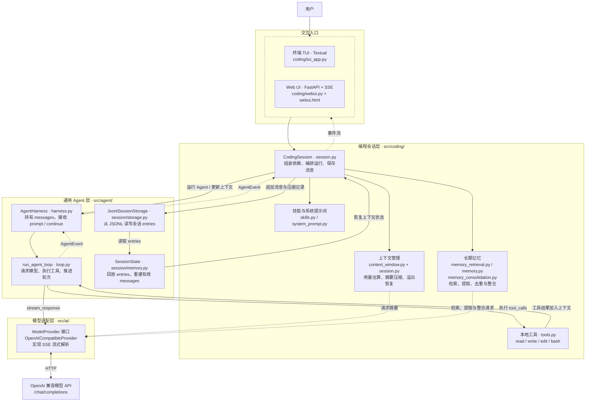
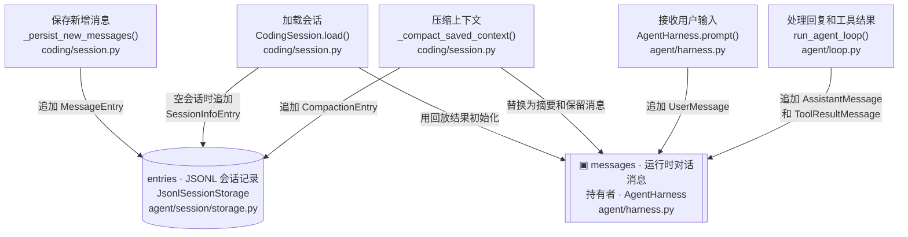
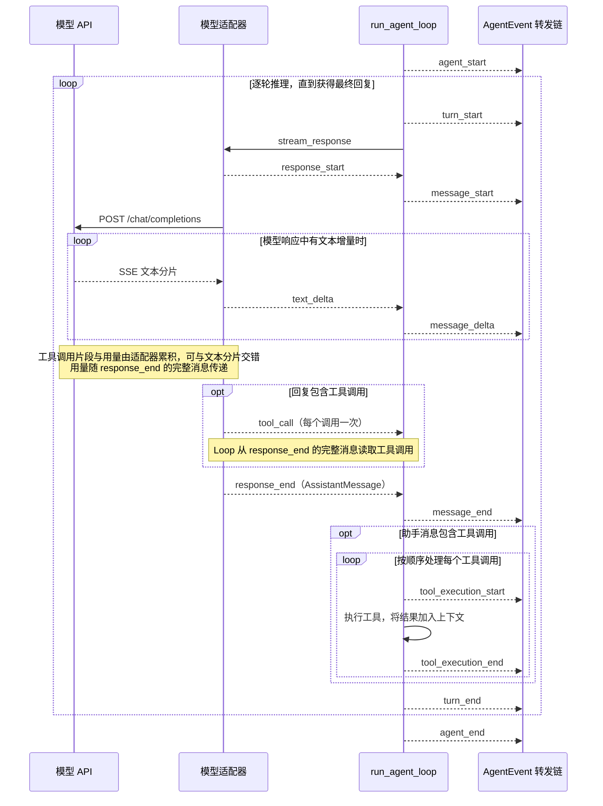

# DirAgent

> An agent that lives in your working directory.

一个 Python 编程 Agent。用户通过终端 TUI 或 Web UI 提交任务，Agent 调用模型进行推理，使用本地工具读取、修改文件和执行命令，并保存会话记录。

## 架构图

下图使用 Mermaid 流程图源代码，展示当前代码中的模块关系。实线表示调用或数据读写，虚线表示事件回传或辅助模型请求。

### 上下文调整

箭头指向操作写入的对象。`entries` 是 JSONL 中的会话记录，`messages` 是 `AgentHarness` 持有的运行时对话消息。[AgentHarness](src/agent/harness.py#L22)

加载和压缩都通过 `SessionState.from_entries()` 从 entries 回放出有效的 messages。压缩追加的 `CompactionEntry` 保存摘要和保留边界，原有 entries 继续留在 JSONL 中。[回放实现](src/agent/session/memory.py#L19)

## 一次运行的事件流

下图展示正常运行的事件，使用事件的 `type` 值。`ProviderEvent` 由模型适配器产出，`AgentEvent` 由 Agent 循环产出。右侧合并了 `AgentHarness → CodingSession → TUI 或 Web 后端` 的转发链。每个发往右侧的 `AgentEvent` 都沿这条链传递。

`agent_end` 表示一次 Agent 循环结束。记忆和压缩请求直接消费模型适配器的事件，界面收到的是主循环的 `AgentEvent`。`ToolExecutionUpdateEvent` 已定义，当前工具执行路径尚未发出该事件。

## 核心流程

1. **加载会话**：`CodingSession.load()` 读取 JSONL，通过 `SessionState` 回放记录，加载技能、系统提示词和本地工具，再创建 `AgentHarness`。
2. **准备上下文**：`CodingSession.prompt()` 按需展开指定技能，注入记忆索引和检索到的记忆正文，并检查自动压缩阈值。
3. **运行 Agent**：`AgentHarness` 追加用户消息，调用 `run_agent_loop()`。循环通过 `ModelProvider` 请求模型；模型返回工具调用时，按顺序执行工具，将结果加入上下文后继续请求，直到获得最终回复、发生终止错误或达到轮次上限。
4. **显示与保存**：运行期间，`AgentEvent` 经由 Session 回传给界面；循环结束后，Session 追加保存本次新增消息。成功运行后，再提取长期记忆，并在满足阈值时整合已有记忆。
5. **压缩与恢复**：压缩将较早的消息生成摘要，追加 `CompactionEntry`，再回放为“摘要 + 近期消息”并替换 Harness 上下文；原始记录继续保留在 JSONL 中。`prompt()` 遇到上下文溢出时，会尝试压缩并继续运行一次。